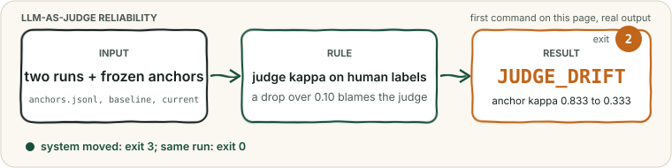

# drift-sentinel

**Eval score moved after a provider model update. You cannot tell whether the system regressed or the judge did.**

[](https://github.com/homayoun-safarpour/judge-drift-sentinel/actions/workflows/ci.yml)


LLM-as-judge reliability: attribute eval-score movement to the system or the LLM judge using a frozen human anchor set and kappa.

drift-sentinel is a small command-line check that tells whether a moved evaluation score came from the system under test or from the language-model judge that grades it. We built it because a judge behind an alias such as `-latest` can change without notice, whereas the score looks the same whichever one moved. Given a frozen set of human-labelled examples that the judge re-scores on every run, it compares the judge's kappa against those labels between two runs and blames the judge when kappa falls by more than 0.10. It prints a verdict and exits 0, 2 or 3, so that CI or an agent loop can stop on judge drift.

```bash
git clone https://github.com/homayoun-safarpour/judge-drift-sentinel
cd judge-drift-sentinel && pip install -e .
drift-sentinel check --anchors examples/anchors.jsonl --baseline examples/run_baseline.json --current examples/run_current.json
```

```text
verdict      : JUDGE_DRIFT
anchor kappa : 0.833 -> 0.333
anchor flips : 25.0% of frozen anchors changed label
judge pin    : CHANGED frontier-4-2026-05-01@9f2c1a -> frontier-4-latest@9f2c1a
live metric  : moved -0.150
reason       : agreement with the frozen human labels fell (0.833 -> 0.333); the ruler moved, not the system
note         : judge is not pinned: frontier-4-2026-05-01@9f2c1a -> frontier-4-latest@9f2c1a
note         : live metric moved -0.150 but is untrustworthy under judge drift
```

That command exits 2. With `--current examples/run_current_system.json` it exits 3, and a run compared with itself exits 0.



[How it works](#how-it-works) · [Results](#what-each-result-means) · [Limits](#limits) · [Interview pack](docs/INTERVIEW.md) · [Cite](#citation) · Part of [a small open stack for checking AI agents and their judges](https://homayoun-safarpour.github.io)

The package is also on PyPI as `judge-drift-sentinel` ([docs/PUBLISH.md](docs/PUBLISH.md)). Contributors use `pip install -e ".[dev]"`.

## What each result means

| Verdict | Exit | Meaning |
|---|---|---|
| `STABLE` | 0 | Kappa fell by 0.10 or less, and the live metric moved by 0.05 or less. |
| `SYSTEM_CHANGE` | 3 | Kappa held, but the live metric moved by more than 0.05. The movement belongs to the system. |
| `JUDGE_DRIFT` | 2 | Kappa fell by more than 0.10, so the live metric cannot be trusted. `history` also exits 2 on slow decay. |
| error | 1 | Bad arguments, an unreadable or malformed file, a run that missed an anchor, an anchor file that no longer matches the pinned freeze hash, anchors that all carry one human label (kappa is undefined there), a `live_metric` in only one run or one that is not a finite number, or a `--kappa-drop` outside 0 to 2 or a negative `--metric-shift`. |

A `STABLE` or `SYSTEM_CHANGE` verdict shows that the judge still agrees with the human labels on the anchors. It does not show that the anchors represent your live traffic, or why a provider changed its model. Claim boundaries: [docs/RELIABILITY_CARD.md](docs/RELIABILITY_CARD.md). Central test: `tests/test_verdict.py::test_drift_on_frozen_anchors_blames_the_judge_not_the_system`.

## Use this when

| Situation | Use drift-sentinel? |
| --- | --- |
| An LLM judge grades your system and the score moved between runs | Yes |
| CI or [agent-loop-engine](https://github.com/homayoun-safarpour/agent-loop-engine) must stop on judge drift | Yes |
| You want to know why a judge panel disagrees right now | No. Use [judge-reliability-kit](https://github.com/homayoun-safarpour/judge-reliability-kit) |
| You have no human-labelled examples | No. Label 10 to 50 outputs first |

## The problem

A judge score can move because the system changed, the judge model changed, someone edited the judge prompt, or the judge varied by chance. All four look the same on a dashboard, so teams roll back healthy deploys or compare charts scored by different judges. A second measurement has to isolate the judge.

## How it works

Label a small set of outputs once, by hand. The human labels never change, so a change in the judge's agreement with them comes from the judge.

1. Keep the anchors as JSONL: `{"id": "a07", "input": "...", "label": "fail"}`.
2. In every eval run, have the judge also score the anchors, and save the scores as JSON (see `examples/run_baseline.json`).
3. Pin an approved run as the baseline, which records the anchor `freeze_hash` (over each anchor's id, input and label) and kappa.
4. Run `check` on each new run.

```bash
drift-sentinel baseline --anchors examples/anchors.jsonl --run examples/run_baseline.json --out baseline.json
```

```text
pinned       : yes
anchor kappa : 0.833
freeze hash  : a8569b1c7428
judge pin    : frontier-4-2026-05-01@9f2c1a
live metric  : 0.810
wrote        : baseline.json
```

For ordinal rubrics, add `--kappa-weights quadratic --kappa-levels 0,1,2,3` so that near misses cost less than far misses. `drift-sentinel history --anchors A --runs R1 R2 R3` checks each consecutive pair and also flags slow decay, where every step stays under `--kappa-drop` but the whole window exceeds it. On `examples/drifting/` it exits 2.

### Worked example (real output)

In the first-screen run the live metric fell from 0.81 to 0.66 because the judge moved to a `-latest` alias, so a rollback would fix nothing. With the same fall and a steady judge, the verdict changes:

```text
$ drift-sentinel check --anchors examples/anchors.jsonl --baseline examples/run_baseline.json --current examples/run_current_system.json
verdict      : SYSTEM_CHANGE
anchor kappa : 0.833 -> 0.833
anchor flips : 0.0% of frozen anchors changed label
judge pin    : held frontier-4-2026-05-01@9f2c1a
live metric  : moved -0.150
reason       : anchor agreement held (0.833 -> 0.833) while the live metric moved -0.150; the movement is real and belongs to your system
```

Fixture map: [examples/README.md](examples/README.md).

| Module | What it does |
|---|---|
| `driftsentinel.anchors` | Loads the anchor set and computes its `freeze_hash` |
| `driftsentinel.agreement` | Cohen's kappa, weighted kappa and flip rate |
| `driftsentinel.verdict` | The three-way decision rule |
| `driftsentinel.baseline` | Pins a baseline; `check` refuses a hash mismatch |
| `driftsentinel.history` | Timeline across many runs, with slow-decay detection |
| `driftsentinel.cli` | `baseline`, `check`, `history`, `import-judgekit`, plain or `--json` |

Interview pack: [docs/INTERVIEW.md](docs/INTERVIEW.md).

## Import from judge-reliability-kit

`import-judgekit` reads a `judgekit.panel_export/v1` file, collapses one judge's replicated labels by majority vote (`--aggregate modal`, or `first`), and writes anchors and a run file.

```bash
drift-sentinel import-judgekit --panel examples/judgekit_panel_export.json --judge gpt-4o-judge --anchors-out anchors.jsonl --run-out run.json
```

```text
imported     : yes
anchors      : 6 labels -> anchors.jsonl
run          : judge gpt-4o-judge -> run.json
judge pin    : gpt-4o-judge@kit-demo-01
```

Bare ratings work with `--human-labels gold.json`. An unknown `schema_version`, malformed JSON or missing ratings exits 1 with an `error:` line, and each case has a named test in `tests/test_adapter.py`.

## CI: weekly anchor re-score

[`.github/workflows/weekly-anchor-rescore.yml`](.github/workflows/weekly-anchor-rescore.yml) runs `check` or `history` every Monday at 06:00 UTC, or on demand with path and mode inputs. On `JUDGE_DRIFT` it opens or comments on an issue titled `JUDGE_DRIFT: weekly anchor re-score detected judge drift` and fails the run. It calls no model and uses only `GITHUB_TOKEN` with `issues: write`. Named test: `tests/test_weekly_rescore_workflow.py`.

## Gate for agent-loop-engine

[agent-loop-engine](https://github.com/homayoun-safarpour/agent-loop-engine) treats only exit 0 as a pass. A raw `--gate "drift=drift-sentinel check ..."` would mark `SYSTEM_CHANGE` (exit 3) as a red gate and block feature work although the judge is fine. The remapper keeps it green, so that repair beats progress only when the judge moved:

```bash
loop-engine tick --state examples/LOOP_STATE.md \
  --gate "tests=python -m pytest -q" \
  --gate "drift=python examples/as_loop_gate.py --anchors examples/anchors.jsonl --baseline examples/run_baseline.json --current examples/run_current_system.json"
```

| Sentinel exit | Wrapper exit | Loop effect |
|---|---|---|
| `0` STABLE | `0` | gate green |
| `3` SYSTEM_CHANGE | `0` | gate green |
| `2` JUDGE_DRIFT | `2` | gate red -> `action: repair` target `drift` |
| `1` error | `1` | gate red -> fix the command or paths |

Named tests: `tests/test_loop_engine_gate_docs.py`.

## Limits

- It is not a judge and not a labelling tool. It calls no model, so your eval job must have the judge re-score the anchors.
- The verdict covers the anchors only. Drift on cases they do not cover can go unseen.
- A changed judge fingerprint is reported, but it does not change the verdict without a kappa drop.
- The thresholds 0.10 and 0.05 are defaults; set them with `--kappa-drop` and `--metric-shift`.
- A plain run file used as `--baseline` carries no freeze hash, so `check` cannot tell whether the anchors changed since it was scored; pin baselines with `drift-sentinel baseline` to get that check.
- When neither run has a `live_metric`, the verdict covers the anchors only, and the output says so in a note.
- It has no runtime dependencies and needs Python 3.10 or later.

## Related tools

- [judge-reliability-kit](https://github.com/homayoun-safarpour/judge-reliability-kit): why a judge panel disagrees at one point in time.
- [agent-loop-engine](https://github.com/homayoun-safarpour/agent-loop-engine): state, gates and the next-step decision for agent loops.
- [judge-field-guide](https://github.com/homayoun-safarpour/judge-field-guide): a link-checked map of tools for LLM judges.

## Contributing

Issues and pull requests are welcome. Run `python -m pytest -q` and `python -m ruff check src tests` before you push.

## Citation

```bibtex
@software{safarpour2026judgedriftsentinel,
  author = {Homayoun Safarpour},
  title  = {judge-drift-sentinel: attribute eval-score movement to the system or the judge},
  year   = {2026},
  url    = {https://github.com/homayoun-safarpour/judge-drift-sentinel}
}
```

Author: Homayoun Safarpour | [LinkedIn](https://www.linkedin.com/in/homayoun-safarpour/)

## License

MIT
